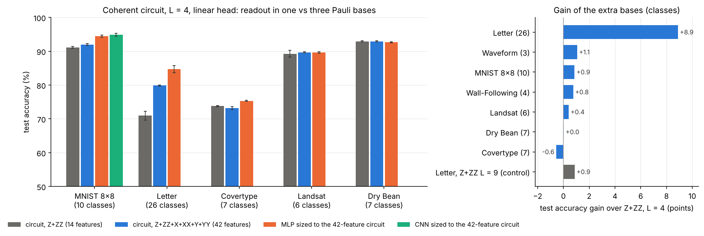

# Extra datasets (12 sets, two batches) with the frozen serialized circuit

Question: do the findings of the MNIST grid (more patches means more parameters at constant qubits, a linear head on the Z + ZZ features) carry over to other data? The MNIST grid (`reports/results.md`, `README.md`) is not touched; everything here is new code (`src/datasets.py`, `src/bench.py`, `src/bench_classical.py`, `src/bench_report.py`) and results in `data/results/bench/`.

## Datasets

| dataset | source | classes | features | patches T | train / val / test | majority class |
|---|---|---|---|---|---|---|
| Waveform | UCI 107 (the 21 wave attributes) | 3 | 21 | 6 | 3601 / 400 / 999 | 33.9% |
| Wall-Following Robot | UCI 194, `sensor_readings_24` | 4 | 24 | 6 | 3929 / 436 / 1091 | 40.4% |
| Covertype | UCI 31 | 7 | 54 | 14 | 10000 / 2000 / 9999 | 48.8% |
| Letter Recognition | UCI 59 | 26 | 16 | 4 | 10000 / 1600 / 4000 | 4.1% |
| Fashion-MNIST | 14x14 (area resize) | 10 | 196 | 49 | 10000 / 2000 / 10000 | 10% |
| BloodMNIST | MedMNIST v2 28x28, grayscale, 14x14 | 8 | 196 | 49 | 8779 / 1527 / 3421 | 19.5% |
| Spambase | UCI 94 | 2 | 57 | 15 | 3313 / 368 / 920 | 60.5% |
| Credit Default | UCI 350 (default of credit card clients) | 2 | 23 | 6 | 10000 / 2000 / 6000 | 77.9% |
| Landsat | UCI 146 (statlog, train + test joined) | 6 | 36 | 9 | 4634 / 514 / 1287 | 23.9% |
| Dry Bean | UCI 602 | 7 | 16 | 4 | 9801 / 1089 / 2721 | 26.1% |
| PneumoniaMNIST | MedMNIST v2 28x28, 14x14, official splits | 2 | 196 | 49 | 4708 / 524 / 624 | 62.5% |
| Kuzushiji-MNIST | 28x28 (Hugging Face `tanganke/kmnist`), 14x14 | 10 | 196 | 49 | 10000 / 2000 / 10000 | 10% |

Batch A1 is the first six rows, batch A2 the last six (`datasets.BATCHES`).

Notes on the choices (each is a caveat for the paper):

- **Waveform**: UCI's version 2 (40 attributes, id 108) has no downloadable data; version 1 (21 attributes, id 107) is used, 5000 examples.
- **Split**: tabular sets use a fixed stratified test set (20% of the data, at most 10000 examples, independent of the seed), a validation set of 10% of the rest (at most 2000, monitoring only) and the remaining examples, at most 10000, as training set. The seed (42, 43, 44) changes the validation / training draw and the initial angles. Classes keep their natural frequencies, so accuracy and balanced accuracy (mean per-class recall) are both reported. The image sets are class balanced and use the official test split (Fashion-MNIST: 1000 training and 200 validation images per class from the training set, like the MNIST grid; BloodMNIST: official train / val / test, balanced draw of at most 1250 / 250 images per class, the smallest class has 849 training images).
- **Features**: clipped to the 1st-99th percentile of the training split and min-max scaled to [0, 1] (statistics from the training split only). The serialization order is the file order (Wall-Following: sensors in circular order; Covertype: 10 quantitative, 4 wilderness, 40 soil indicators; Letter: the 16 features of the file), padded with zeros to a multiple of 4. The order is part of the model and was not tuned; a permutation control is a possible follow-up.
- **Kuzushiji-MNIST**: the original host (codh.rois.org) is down; the Hugging Face copy `tanganke/kmnist` was used (60000 / 10000 images, 10 balanced classes, checked against the published sizes). Same balanced draw as Fashion-MNIST.
- **PneumoniaMNIST** keeps the official (imbalanced) splits; its test set is small (624 images) and is known to differ from the training distribution, so its numbers move more than the others.
- **Credit Default**: the categorical codes (sex, education, marriage, payment status) are kept as numbers, not one-hot encoded.
- **BloodMNIST** is converted to grayscale (luminance), which discards the colour that carries much of the class information; this follows the dataset plan (all images 14x14 grayscale) and is a caveat, not a claim about the dataset.

## Models

Circuit: exactly the frozen configuration of the MNIST grid (`src/qcircuit.py`: 4 pixel qubits + 3 ancilla qubits, xyz encoding, Z + ZZ readout, linear head, init 0.08, **coherent** memory, **L = 4**), trained with the same recipe (100 epochs, Adam lr 0.01 with cosine decay to 5%, batch 256, gradient clip 5, last epoch reported, no early stopping, no model selection). The only dataset-dependent setting is the encoding scale, `min(1, 16 / T)`, which gives 1.0 for 4 to 14 patches (the 8x8 value of the grid, about 16 / patches) and 0.33 for 49 patches (the 14x14 value). Seeds 42, 43, 44; training cap 10000.

Classical baselines on the same arrays (`src/bench_classical.py`), same recipe, learning rate (0.001 / 0.003 / 0.01) chosen by mean validation accuracy:

- logistic regression;
- one-hidden-layer MLP and (images) the small CNN of `src/classical.py`, both sized to the parameter count of the circuit with L = 4 on the same dataset;
- a strong, untuned baseline: scikit-learn `HistGradientBoostingClassifier` (300 iterations, learning rate 0.1, L2 1.0) on the raw features / pixels. (Without the L2 term two of three Covertype seeds diverged to about 60%; the setting was fixed after seeing that, the test accuracy did not enter the choice.)

Amplitude-encoding baseline (`src/bench_amplitude.py`, model of `src/amplitude.py`): no serialization; the whole example is the amplitude vector of 7 qubits (tabular vectors zero-padded to 128 values, 14x14 images area-shrunk to 11x11 as in the MNIST grid), followed by 4 layers of the same Rot + CRot-chain block, Z + ZZ readout, linear head. 7 qubits is the register of the serialized circuit; 4 layers is its frozen setting. Its parameter count (200 to 550) does not grow with the input, which is the point of comparison.

Measured memory (`python src/bench.py --set measured`): the same circuit in the hardware-style mode of the MNIST grid (the ancilla is measured after every patch and only its 3 classical bits connect the patches). It tests whether the weak order / dependence between patches matters. Run only on the four tabular sets (4 to 14 patches); the image sets (49 patches) would take days per run (cost about 4.5 times the coherent runs below).

Head experiment (single, as agreed): the same circuit with a one-hidden-layer MLP head (64 units) on the Z + ZZ features instead of the linear layer, on Letter (26 classes), 3 seeds. All main runs keep the linear head.

## Cost (one core, 3 training steps timed, batch 256)

| dataset | steps / epoch | seconds / step | hours for 100 epochs |
|---|---|---|---|
| Letter | 40 | 0.58 | 0.65 |
| Waveform | 15 | 0.96 | 0.40 |
| Wall-Following | 16 | 0.86 | 0.38 |
| Covertype | 40 | 3.4 | 3.8 |
| BloodMNIST | 35 | 13.0 | 12.7 |
| Fashion-MNIST | 40 | 13.0 | 14.4 |

Peak memory 1.4 to 2.0 GB per run. Measured memory, same units: Letter 3.1 h, Waveform 1.8 h, Wall-Following 1.8 h, Covertype 11 h.

## Readout in all three Pauli bases (small test, for the discussion)

Coherent L = 4, linear head, seeds 42-44; the only change is the readout: Z, ZZ (14 features, the frozen setting) versus Z, ZZ, X, XX, Y, YY (42 features) of the same final state (`python src/bench.py --set readout`). Control: Z, ZZ with a deeper circuit, L = 9, about the parameter count of the 42-feature model (`--set control`). Test accuracy %, last epoch:

| dataset | Z, ZZ (L = 4) | Z, ZZ, X, XX, Y, YY (L = 4) | Z, ZZ (L = 9), capacity control |
|---|---|---|---|
| Letter (26 classes) | 71.0 ± 1.3 (1089 params) | 79.9 ± 0.1 (1817) | 71.9 ± 1.7 (1869) |
| Wall-Following (4) | 90.1 ± 0.6 (1071) | 90.9 ± 1.2 (1183) | - |
| Waveform (3) | 85.0 ± 0.2 (1056) | 86.0 ± 0.5 (1140) | - |

At equal parameter count the extra bases add about 8 points on Letter and about 1 point on the 3- and 4-class sets. On hardware X and Y need two more measurement settings (3x the shots). Kept out of the main experiments; a LaTeX paragraph for the discussion is in `paper/discussion_readout.tex`. The extended experiment on more datasets is the section "Multi-basis readout" below.

## Note for the paper: boosting also applies to circuits

Gradient boosting is the strongest classical model on every dataset here (Letter 95%, Wall-Following 99.9%), and nothing makes it classical-only: the base learner can be a small circuit. A boosted ensemble of serialized circuits (each fitted to the residual or reweighted data of the previous ones) is a natural way to add capacity without adding qubits or depth, and is an alternative to a larger head. This is stated as an observation; no boosted circuits were run.

## Results

All runs finished (12 datasets x 3 seeds; measured memory on the 8 tabular sets). Test accuracy %, last epoch, mean over seeds 42-44 (standard deviations, balanced accuracy and the best-validation reading are in `reports/bench_results.md`, made by `python src/bench_report.py`). Circuit = coherent memory, L = 4, Z + ZZ readout, linear head; MLP / CNN are sized to the parameter count of that circuit (column "params").

| dataset | classes | T | params | logistic | MLP | CNN | grad. boosting | circuit | circuit, measured | amplitude 7q L4 | amplitude 7q L8 |
|---|---|---|---|---|---|---|---|---|---|---|---|
| Waveform | 3 | 6 | 1056 | **87.2** | 87.1 | - | 85.5 | 85.0 | 82.7 | 86.2 | 86.8 |
| Wall-Following | 4 | 6 | 1071 | 68.3 | 91.9 | - | **99.9** | 90.1 | 87.0 | 73.0 | 77.1 |
| Covertype | 7 | 14 | 2364 | 71.6 | 75.8 | - | **82.2** | 73.8 | 71.7 | 71.7 | 72.0 |
| Letter | 26 | 4 | 1089 | 72.6 | 80.4 | - | **95.3** | 71.0 | 63.5 | 59.7 | 63.6 |
| Fashion-MNIST | 10 | 49 | 7869 | 82.6 | 85.2 | 85.7 | **86.5** | 82.7 | - | 73.7 | 74.4 |
| BloodMNIST | 8 | 49 | 7839 | 67.2 | 70.3 | 81.2 | **86.0** | 73.8 | - | 58.0 | 60.2 |
| Spambase | 2 | 15 | 2445 | 92.0 | 93.4 | - | **96.1** | 91.7 | 93.5 | 90.0 | 90.7 |
| Credit Default | 2 | 6 | 1041 | 81.1 | 81.7 | - | 81.4 | 81.9 | **82.4** | 79.6 | 79.7 |
| Landsat | 6 | 9 | 1569 | 82.3 | 89.2 | - | **92.3** | 89.3 | 86.8 | 78.7 | 78.9 |
| Dry Bean | 7 | 4 | 804 | 92.1 | 92.3 | - | 92.8 | **92.9** | 92.8 | 91.8 | 91.8 |
| PneumoniaMNIST | 2 | 49 | 7749 | 83.5 | 84.1 | 85.6 | 84.9 | **87.7** | - | 81.2 | 81.9 |
| Kuzushiji-MNIST | 10 | 49 | 7869 | 68.2 | 78.7 | 80.3 | **83.4** | 70.4 | - | 58.3 | 62.6 |

What carries over from the MNIST grid:

- **Circuit vs a classical model of the same size.** The circuit is within about 2.5 points of the same-size MLP on 8 of 12 sets (Waveform, Wall-Following, Covertype, Fashion-MNIST, Spambase, Credit Default, Landsat, Dry Bean; equal or slightly above on the last three), above it on BloodMNIST (+3.5) and PneumoniaMNIST (+3.6), and clearly below on the two sets with many classes and little structure per feature, Letter (-9.4, 26 classes) and Kuzushiji-MNIST (-8.3). On the images the same-size CNN stays ahead except on PneumoniaMNIST (small, shifted test set: treat that win with care).
- **Serialization vs amplitude encoding on the same 7 qubits.** The serialized circuit beats amplitude encoding (4 or 8 layers) on 11 of 12 sets, by 6 to 14 points (against the better of the two amplitude models) on Wall-Following, Landsat, Letter and the four image sets; Waveform is the exception (amplitude L8 86.8 vs 85.0). Doubling the amplitude layers (L4 to L8) adds 0 to about 4 points and closes none of the large gaps: the amplitude model has 200 to 550 parameters whatever the input size, the serialized one grows with the number of patches.
- **Coherent vs measured memory.** Coherent memory is better on 6 of 8 tabular sets (Letter -7.5, Wall-Following -3.1, Landsat -2.5, Waveform -2.3, Covertype -2.1, Dry Bean -0.1); measured memory is slightly better on the two binary sets (Spambase +1.8, Credit Default +0.5). The quantum link between patches helps most where there are many classes; for the binary tasks the 3-bit classical link is enough. Measured runs are also noisier across seeds (Waveform ± 2.5, Letter ± 2.6) and several times slower to simulate (see Cost).
- **Gradient boosting** is the best model on 8 of 12 sets and is far ahead where the features need sharp thresholds (Wall-Following 99.9, Letter 95.3). On Credit Default, Dry Bean and PneumoniaMNIST the circuit is level with or above it.
- **Last epoch vs best-validation checkpoint** (best of the 10 checkpoints at epochs 10, 20, ..., 100): the two readings differ by at most 0.4 points in all circuit cells except Spambase (91.7 last, 90.7 best-val), and by at most 1.5 points anywhere in the table. The best-val reading is not systematically higher, so the conclusions do not depend on it; the main tables keep the last epoch, as in the grid.

Head experiment (Letter, 3 seeds): an MLP head (64 hidden units, 3349 parameters) raises the circuit from 71.0 to 85.6, but a classical MLP with the same 3349 parameters reaches 87.8. The head closes most of the gap to the classical model; the circuit features alone do not.

## Multi-basis readout (separate experiment)

Question: with the circuit fixed (coherent, L = 4, linear head), does measuring the final state in all three Pauli bases instead of Z only help, and is the gain more than the extra head parameters? Readout Z, ZZ, X, XX, Y, YY of the final state on all 7 qubits: 42 features instead of 14 (7 single-qubit terms + 7 nearest-neighbour pair terms per basis, ring order). The circuit is unchanged; only the head grows, from 15 k to 43 k parameters for k classes. On hardware X and Y need two more measurement settings (3x the shots).

Group (decided 2026-11-06): the cheap sets with more than 4 classes, MNIST 10 classes 8x8 (the grid task, 16 patches), Letter, Covertype, Landsat, Dry Bean; Wall-Following (4 classes) and Waveform (3) as small-class checks; the expensive 49-patch sets are left out. Baselines: the MLP (and for MNIST the CNN) re-sized to the parameter count of the 42-feature circuit (`mlp_mb`, `cnn_mb` in `src/bench_classical.py`; `--set multibasis` in `src/classical.py` and `src/train.py`). Table and figure: `python src/multibasis_report.py` -> `reports/multibasis.md`, `reports/figures/fig_multibasis.png`.

Test accuracy %, last epoch, mean ± std over 3 seeds, parameters in brackets:

| dataset | classes | circuit Z+ZZ | circuit Z+ZZ+X+XX+Y+YY | gain | MLP sized to Z+ZZ circuit | MLP sized to 42-feature circuit | CNN sized to 42-feature circuit |
|---|---|---|---|---|---|---|---|
| MNIST 8x8 | 10 | 91.1 ± 0.3 (2721) | 92.0 ± 0.3 (3001) | +0.9 | 94.7 ± 0.3 (2710) | 94.5 ± 0.3 (3010) | 94.9 ± 0.4 (2986) |
| Letter | 26 | 71.0 ± 1.3 (1089) | 79.9 ± 0.1 (1817) | +8.9 | 80.4 ± 0.7 (1101) | 84.7 ± 1.0 (1832) | - |
| Covertype | 7 | 73.8 ± 0.1 (2364) | 73.2 ± 0.4 (2560) | -0.6 | 75.8 ± 0.2 (2363) | 75.3 ± 0.2 (2549) | - |
| Landsat | 6 | 89.3 ± 1.0 (1569) | 89.7 ± 0.2 (1737) | +0.4 | 89.2 ± 0.1 (1554) | 89.6 ± 0.2 (1726) | - |
| Dry Bean | 7 | 92.9 ± 0.1 (804) | 92.9 ± 0.1 (1000) | +0.0 | 92.3 ± 0.1 (799) | 92.6 ± 0.2 (991) | - |
| Wall-Following | 4 | 90.1 ± 0.6 (1071) | 90.9 ± 1.2 (1183) | +0.8 | 91.9 ± 0.3 (1077) | - | - |
| Waveform | 3 | 85.0 ± 0.2 (1056) | 86.0 ± 0.5 (1140) | +1.1 | 87.1 ± 0.7 (1053) | - | - |

Capacity control: Letter with Z + ZZ and a deeper circuit, L = 9 (1869 parameters, more than the 1817 of the 42-feature model): 71.9 ± 1.7.

Findings:

- The extra bases help a lot only on Letter (+8.9 points), the set with by far the most classes for its features (26 classes from 4 patches, 14 Z + ZZ features). There the gain is not a parameter-count effect: spending the same number of parameters on depth (L = 9) gives +0.9. Elsewhere the gain is -0.6 to +1.1 points, about the seed spread.
- The re-sized classical models stay level or ahead: the MLP sized to the 42-feature circuit gains on Letter too (+4.3) and little or nothing on the other sets, so the ranking of circuit vs classical model does not change; on Landsat and Dry Bean the two are level with either readout. On MNIST 8x8 the gap to the MLP / CNN shrinks from about 3.6 to 2.5 points.
- Reading: with a linear head, Z + ZZ features are a bottleneck when the number of classes is large compared to the number of features (14 features for 26 classes); X and Y expectation values carry information that the Z basis does not, and they are almost free in parameters. For 10 or fewer classes Z + ZZ is close to enough.

## Summary

Across 12 datasets the frozen serialized circuit with 7 qubits and a linear head is close to (within about 2.5 points of) a classical MLP with the same number of parameters on 8 sets, ahead on 2 and behind on the 2 sets with many classes and weak per-feature signal (Letter, Kuzushiji-MNIST); it beats amplitude encoding on the same 7 qubits on 11 of 12. Coherent memory beats measured memory on 6 of 8 tabular sets. Gradient boosting is the strongest model on 8 of 12 sets. The findings of the MNIST grid carry over: parameters that grow with the number of patches at a constant register help, and the remaining gap to classical models is largest where the head sees too few features for the number of classes, which the multi-basis readout partly fixes (Letter) without changing the circuit.

Possible next batch (not run): stop at these 12 sets; the remaining Tier B sets of the list would mostly repeat the tabular cases already covered. If more evidence is needed, a feature-order permutation control on two tabular sets and a boosted ensemble of small circuits on Letter are more informative than more datasets.
