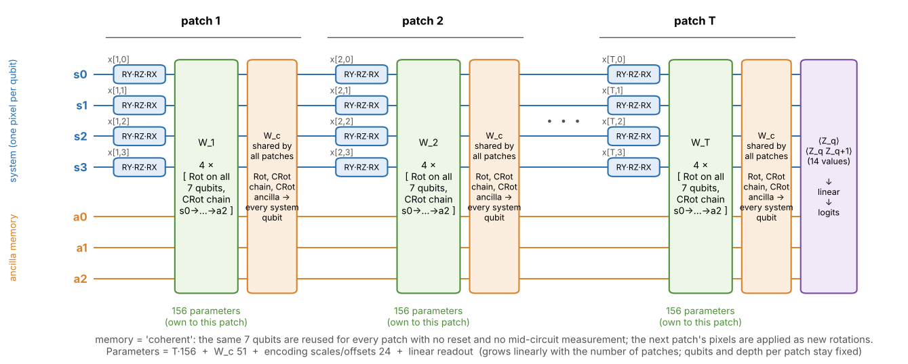
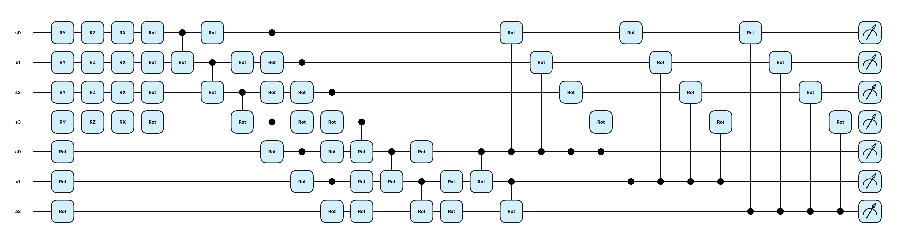
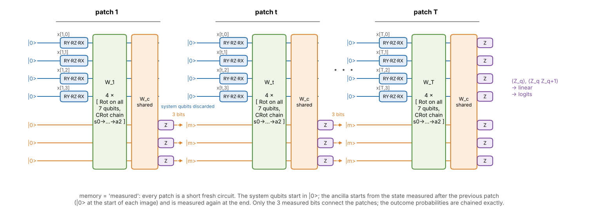

# The serialized circuit (PennyLane, `src/qcircuit.py`)

One class, `SerializedQC`, built only from native PennyLane gates. Every gate is parameterized (no CNOT/CZ) and there are no hand-built matrices. It has two ways of carrying memory from patch to patch (`memory="coherent"` or `"measured"`, below).

## What the circuit does
- **Register:** 4 system qubits (`s0..s3`, one pixel each) and 3 ancilla qubits (`a0..a2`) that carry memory.
- **Patch t** (a 2x2 block of pixels, serpentine order), in this order:
  1. *Encoding* of pixel `x` on its system qubit: `RY(pi(s1 x + o1))  RZ(pi(s2 sqrt(1-x^2) + o2))  RX(pi(s3 x^3 + o3))`. The scales `s` and offsets `o` are trainable, one set per qubit.
  2. *W_t*, trainable and **specific to patch t**: `L = 4` times [`Rot` on all 7 qubits, then a chain of `CRot(q -> q+1)` for q = 0..5].
  3. *W_c*, trainable and **shared by all patches**: `Rot` on the 3 ancilla qubits, a `CRot` chain on the ancilla, then `CRot(a_j -> s_q)` from every ancilla qubit to every system qubit (12 gates), so the memory is entangled with the whole system at every patch.
- **Readout:** `<Z_q>` on all 7 qubits and `<Z_q Z_q+1>` on the ring (14 numbers; `readout="z"` or `"zz"` gives 7), then one linear layer to the class logits.
- `Rot(phi, theta, omega)` = RZ(omega) RY(theta) RZ(phi) has 3 angles. `CRot` is the controlled `Rot`, also 3 angles. A layer therefore has 3 angles per qubit and 3 per chain bond.

PennyLane's own drawing of one patch (2 layers instead of 4, for width), from `SerializedQC(n_steps=1, layers=2).draw()`:

## Memory between patches
- **`coherent`** (figure above): all 7 qubits keep their quantum state through the whole image, with no reset and no mid-circuit measurement. This needs coherence over all patches.
- **`measured`** (figure below): every patch is a short fresh circuit. The system qubits start in |0>. The ancilla qubits start from the state measured at the end of the previous patch, and from |0> at the start of every image, and they are measured again at the end of the patch. Only the 3 measured bits connect the patches, which is what current hardware can do.

A direct density-matrix simulation of the mid-circuit measurements was about 20 times slower than the state-vector simulation and ran out of memory at 7 qubits (16 GB), so it cannot be used for training. Because the system qubits are reloaded and the ancilla is classical after each measurement, the process is a Markov chain over the 2^3 = 8 ancilla states, and it is simulated exactly: for each possible previous outcome the patch circuit is simulated (batch x 8 pure states) and the outcome probabilities are chained; the readout after the last patch is averaged over the final distribution. `tests/test_qcircuit.py` checks this against a density-matrix simulation (Z measurement `PhaseDamping(1)`, reset `AmplitudeDamping(1)`) to 1e-5.

## Parameters grow with the image, the circuit does not
Per patch: `L x (3n + 3(n-1)) = 156` for n = 7, L = 4. In total `T x 156 + 51 (W_c) + 24 (encoding) + 14k + k (readout, k classes)`. The qubit count and the depth per patch stay fixed. Counts below are for k = 10 and were checked against the class (`tests/test_qcircuit.py`):

| image | patches T | L = 2 | L = 4 | L = 8 |
|---|---|---|---|---|
| 8x8 | 16 | 1,473 | 2,721 | 5,217 |
| 14x14 | 49 | 4,047 | 7,869 | 15,513 |
| 28x28 | 196 | 15,513 | 30,801 | 61,377 |

For comparison, a one-hidden-layer MLP with the same number of parameters has 36 hidden units for the 2,721-parameter 8x8 circuit and 39 for the 30,801-parameter 28x28 circuit (L = 4), so the circuit can be given the size of a small classical network while using 7 qubits.

## Checks (`tests/test_qcircuit.py`, 12 tests, all pass)
- parameter count formula; only `RY RZ RX Rot CRot` gates occur and all are parameterized; every ancilla qubit is coupled to every system qubit;
- each patch has its own parameters (all receive gradient), and the memory carries early patches to the output;
- the 14 outputs are expectation values in [-1, 1];
- gradients match finite differences;
- `lightning.qubit` (adjoint) and `default.qubit` (backprop) agree to 1e-12 on outputs and gradients (measured about 1e-16);
- `measured` memory equals a density-matrix simulation with measurements and resets, equals the coherent circuit for one patch, differs from it for several patches, and every patch receives gradient.

## Expressivity: how many parameters are independent?
Rank of the Jacobian of the 14 outputs with respect to the quantum parameters at a random point (`scripts/expressivity.py`; 64 random inputs, so 896 rows, 4 patches):

| layers | quantum parameters | Jacobian rank | share |
|---|---|---|---|
| 1 | 231 | 213 | 92% |
| 2 | 387 | 333 | 86% |
| 4 | 699 | 573 | 82% |

So most parameters are independent directions, but 8-18% are redundant. In a smaller case (2 patches, 1 layer) I looked at the null directions: 3 are exactly inert (the first `RZ` of `Rot` on each ancilla qubit acts on |0>), and others tie a z-rotation of one patch to a z-rotation of the next patch or of W_c on the same qubit, because `RZ` commutes with the control of a `CRot`. This is the usual Euler-angle redundancy of rotation layers. It does not reduce the circuit's reach, it only means the parameter count overstates the number of free directions by that share.

## Speed of the two simulators (7 qubits, 16 patches, L = 4; one training step = forward, backward, Adam; 1 core, 4 jobs at once)
| device | batch | time per step |
|---|---|---|
| `default.qubit`, backprop | 128 | about 2.4 s |
| `default.qubit`, backprop | 1000 | about 6.5 s |
| `lightning.qubit`, adjoint | 1 | about 1.1 s |
| `lightning.qubit`, adjoint | 128 | about 117 s |
| `default.qubit`, `memory="measured"` (8 start states per image, checkpointed) | 128 | about 10.7 s (1.5 GB) |

`default.qubit` applies every gate to the whole batch at once (parameter broadcasting). `lightning.qubit` has no broadcasting, so PennyLane builds and runs one circuit per image, and with only 7 qubits (128 amplitudes) the per-gate Python overhead, not the state-vector work, is the cost. Lightning pays off for circuits of roughly 20 qubits or more, not here. A training step costs roughly 1 ms per gate on one core at batch 256 (about 55 gates per patch with 2 layers, 81 with 4), so the time grows linearly with the number of patches and updates; `memory="measured"` costs about 4.5 times as much. At 28x28 (196 patches) one coherent step at batch 256 needs about 13 GB (2 layers) to 19 GB (4 layers) of RAM, measured memory about 8-10 GB (checkpointed per patch).
