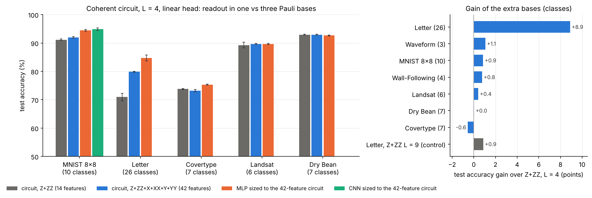

# Multi-basis readout: generated table

Generated by `python src/multibasis_report.py` (setup and discussion in `reports/bench.md`). Test accuracy %, last epoch, mean ± std over seeds 42-44, trainable parameters in brackets (circuit + linear head; the classical models are sized to these counts). T = patches.

| dataset | classes | T | circuit Z+ZZ | circuit Z+ZZ+X+XX+Y+YY | gain | MLP sized to Z+ZZ circuit | MLP sized to 42-feature circuit | CNN sized to Z+ZZ circuit | CNN sized to 42-feature circuit |
|---|---|---|---|---|---|---|---|---|---|
| MNIST 8x8 | 10 | 16 | 91.1 ± 0.3 (2721) | 92.0 ± 0.3 (3001) | +0.9 | 94.7 ± 0.3 (2710) | 94.5 ± 0.3 (3010) | 95.3 ± 0.1 (2540) | 94.9 ± 0.4 (2986) |
| Letter | 26 | 4 | 71.0 ± 1.3 (1089) | 79.9 ± 0.1 (1817) | +8.9 | 80.4 ± 0.7 (1101) | 84.7 ± 1.0 (1832) | - | - |
| Covertype | 7 | 14 | 73.8 ± 0.1 (2364) | 73.2 ± 0.4 (2560) | -0.6 | 75.8 ± 0.2 (2363) | 75.3 ± 0.2 (2549) | - | - |
| Landsat | 6 | 9 | 89.3 ± 1.0 (1569) | 89.7 ± 0.2 (1737) | +0.4 | 89.2 ± 0.1 (1554) | 89.6 ± 0.2 (1726) | - | - |
| Dry Bean | 7 | 4 | 92.9 ± 0.1 (804) | 92.9 ± 0.1 (1000) | +0.0 | 92.3 ± 0.1 (799) | 92.6 ± 0.2 (991) | - | - |
| Wall-Following | 4 | 6 | 90.1 ± 0.6 (1071) | 90.9 ± 1.2 (1183) | +0.8 | 91.9 ± 0.3 (1077) | - | - | - |
| Waveform | 3 | 6 | 85.0 ± 0.2 (1056) | 86.0 ± 0.5 (1140) | +1.1 | 87.1 ± 0.7 (1053) | - | - | - |

Capacity control: Letter, Z+ZZ with L = 9: 71.8 ± 1.7 (1869).

