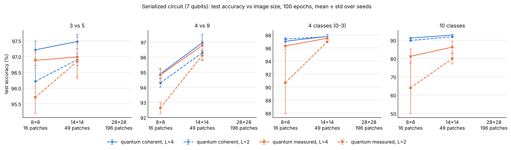
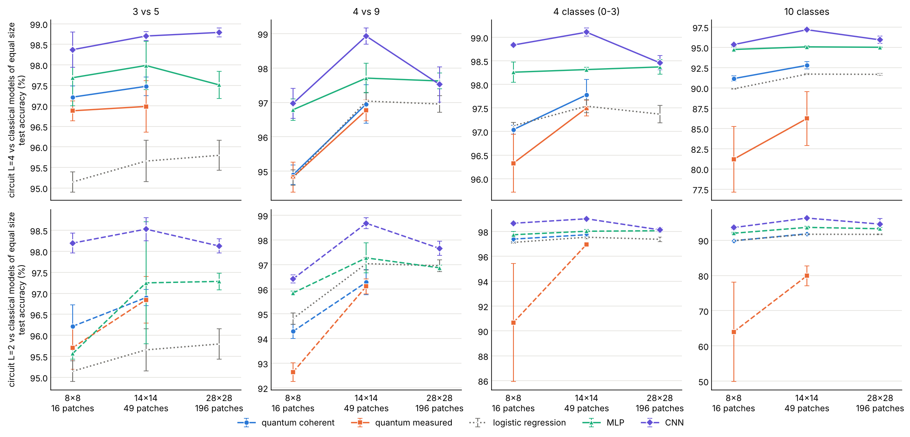
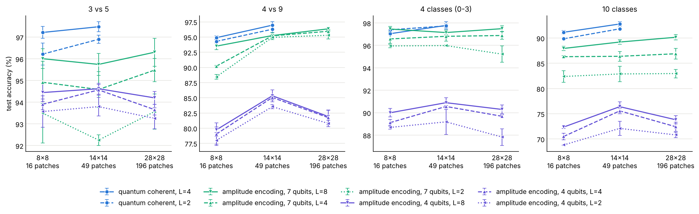
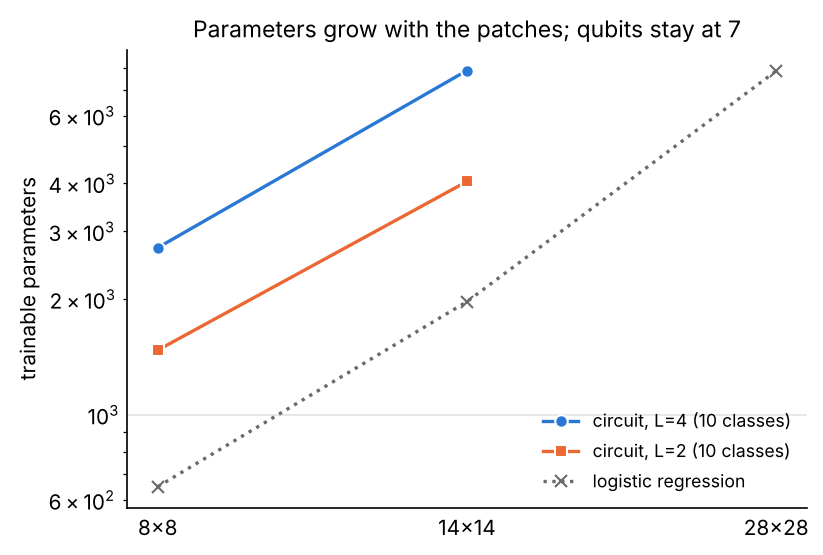
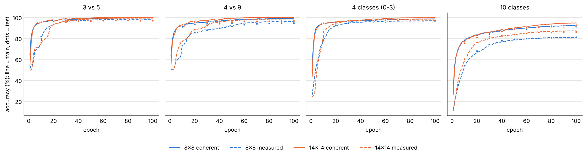

# Results of the fixed grid

Finished runs: 312 quantum (serialized circuit and amplitude-encoding baselines), 180 classical (best learning rate only). Fixed settings: MNIST, 2x2 patches (4 pixel qubits + 3 ancilla qubits), 1000 training images per class, 200 validation images per class (monitoring only), the full MNIST test set of the chosen digits, 100 epochs, Adam lr 0.01 with cosine decay to 5%, batch 256, no early stopping or model selection (last epoch is reported).

Note: the serialized circuit was not run at 28x28 (196 patches). The simulation was too slow: one epoch took about 47 minutes for 3 vs 5 and 4 vs 9 and about 2 hours for 10 classes with coherent memory (about 1 hour for 3 vs 5 with measured memory), on a machine shared with other jobs, so 100 epochs would need about 3 days (2 classes) to 8 days (10 classes) per run. With the grid recipe the circuit also did not train (reports/caution_28x28.md). The classical and amplitude-encoding baselines are shown at 28x28.

## Test accuracy (%), mean ± std over seeds (n)

### 3 vs 5

| model | 8x8 | 14x14 | 28x28 |
|---|---|---|---|
| quantum coherent, L=4 | 97.2 ± 0.3 (3) | 97.5 ± 0.2 (3) | - |
| quantum coherent, L=2 | 96.2 ± 0.5 (3) | 96.9 ± 0.2 (3) | - |
| quantum measured, L=4 | 96.9 ± 0.2 (3) | 97.0 ± 0.6 (3) | - |
| quantum measured, L=2 | 95.7 ± 0.5 (3) | 96.8 ± 0.6 (3) | - |
| logistic regression | 95.1 ± 0.2 (3) | 95.7 ± 0.5 (3) | 95.8 ± 0.4 (3) |
| MLP (sized as L=4) | 97.7 ± 0.7 (3) | 98.0 ± 0.6 (3) | 97.5 ± 0.3 (3) |
| MLP (sized as L=2) | 95.6 ± 0.1 (3) | 97.2 ± 1.5 (3) | 97.3 ± 0.2 (3) |
| CNN (sized as L=4) | 98.4 ± 0.4 (3) | 98.7 ± 0.1 (3) | 98.8 ± 0.1 (3) |
| CNN (sized as L=2) | 98.2 ± 0.2 (3) | 98.5 ± 0.3 (3) | 98.1 ± 0.2 (3) |
| amplitude encoding, 7 qubits, L=8 | 96.0 ± 0.5 (3) | 95.7 ± 0.5 (3) | 96.3 ± 0.6 (3) |
| amplitude encoding, 7 qubits, L=4 | 94.9 ± 1.0 (3) | 94.6 ± 0.8 (3) | 95.5 ± 0.5 (3) |
| amplitude encoding, 7 qubits, L=2 | 93.5 ± 1.4 (3) | 92.3 ± 0.2 (3) | 93.6 ± 0.8 (3) |
| amplitude encoding, 4 qubits, L=8 | 94.4 ± 0.4 (3) | 94.6 ± 0.2 (3) | 94.2 ± 0.3 (3) |
| amplitude encoding, 4 qubits, L=4 | 93.9 ± 0.2 (3) | 94.6 ± 0.2 (3) | 93.7 ± 0.2 (3) |
| amplitude encoding, 4 qubits, L=2 | 93.6 ± 0.7 (3) | 93.8 ± 0.4 (3) | 93.3 ± 0.5 (3) |

### 4 vs 9

| model | 8x8 | 14x14 | 28x28 |
|---|---|---|---|
| quantum coherent, L=4 | 94.9 ± 0.3 (3) | 97.0 ± 0.6 (3) | - |
| quantum coherent, L=2 | 94.3 ± 0.3 (3) | 96.3 ± 0.5 (3) | - |
| quantum measured, L=4 | 94.8 ± 0.4 (3) | 96.8 ± 0.3 (3) | - |
| quantum measured, L=2 | 92.6 ± 0.4 (3) | 96.1 ± 0.3 (3) | - |
| logistic regression | 94.8 ± 0.2 (3) | 97.0 ± 0.3 (3) | 97.0 ± 0.2 (3) |
| MLP (sized as L=4) | 96.8 ± 0.3 (3) | 97.7 ± 0.4 (3) | 97.6 ± 0.2 (3) |
| MLP (sized as L=2) | 95.8 ± 0.1 (3) | 97.3 ± 0.6 (3) | 96.9 ± 0.1 (3) |
| CNN (sized as L=4) | 97.0 ± 0.4 (3) | 98.9 ± 0.2 (3) | 97.5 ± 0.5 (3) |
| CNN (sized as L=2) | 96.4 ± 0.2 (3) | 98.7 ± 0.2 (3) | 97.7 ± 0.3 (3) |
| amplitude encoding, 7 qubits, L=8 | 93.5 ± 0.6 (3) | 95.2 ± 0.5 (3) | 96.4 ± 0.3 (3) |
| amplitude encoding, 7 qubits, L=4 | 90.2 ± 0.1 (3) | 95.2 ± 0.1 (3) | 95.9 ± 0.3 (3) |
| amplitude encoding, 7 qubits, L=2 | 88.4 ± 0.4 (3) | 94.9 ± 0.4 (3) | 95.3 ± 0.6 (3) |
| amplitude encoding, 4 qubits, L=8 | 79.7 ± 0.5 (3) | 85.3 ± 1.0 (3) | 81.9 ± 1.1 (3) |
| amplitude encoding, 4 qubits, L=4 | 79.0 ± 1.8 (3) | 85.0 ± 0.4 (3) | 81.7 ± 1.2 (3) |
| amplitude encoding, 4 qubits, L=2 | 78.0 ± 0.6 (3) | 83.5 ± 0.3 (3) | 80.8 ± 0.5 (3) |

### 4 classes (0-3)

| model | 8x8 | 14x14 | 28x28 |
|---|---|---|---|
| quantum coherent, L=4 | 97.0 ± 0.1 (3) | 97.8 ± 0.3 (3) | - |
| quantum coherent, L=2 | 97.4 ± 0.2 (3) | 97.7 ± 0.2 (3) | - |
| quantum measured, L=4 | 96.3 ± 0.6 (3) | 97.5 ± 0.2 (3) | - |
| quantum measured, L=2 | 90.7 ± 4.8 (3) | 97.0 ± 0.1 (3) | - |
| logistic regression | 97.1 ± 0.1 (3) | 97.5 ± 0.1 (3) | 97.4 ± 0.2 (3) |
| MLP (sized as L=4) | 98.3 ± 0.2 (3) | 98.3 ± 0.0 (3) | 98.4 ± 0.2 (3) |
| MLP (sized as L=2) | 97.7 ± 0.3 (3) | 98.0 ± 0.1 (3) | 98.1 ± 0.2 (3) |
| CNN (sized as L=4) | 98.8 ± 0.0 (3) | 99.1 ± 0.1 (3) | 98.5 ± 0.2 (3) |
| CNN (sized as L=2) | 98.7 ± 0.1 (3) | 99.0 ± 0.1 (3) | 98.1 ± 0.2 (3) |
| amplitude encoding, 7 qubits, L=8 | 97.5 ± 0.2 (3) | 97.1 ± 0.2 (3) | 97.5 ± 0.3 (3) |
| amplitude encoding, 7 qubits, L=4 | 96.6 ± 0.4 (3) | 96.8 ± 0.4 (3) | 96.9 ± 0.3 (3) |
| amplitude encoding, 7 qubits, L=2 | 96.0 ± 0.2 (3) | 96.0 ± 0.1 (3) | 95.2 ± 0.7 (3) |
| amplitude encoding, 4 qubits, L=8 | 90.0 ± 0.4 (3) | 90.9 ± 0.4 (3) | 90.3 ± 0.4 (3) |
| amplitude encoding, 4 qubits, L=4 | 89.1 ± 0.3 (3) | 90.6 ± 0.1 (3) | 89.7 ± 0.2 (3) |
| amplitude encoding, 4 qubits, L=2 | 88.7 ± 0.1 (3) | 89.2 ± 1.1 (3) | 87.8 ± 0.7 (3) |

### 10 classes

| model | 8x8 | 14x14 | 28x28 |
|---|---|---|---|
| quantum coherent, L=4 | 91.1 ± 0.3 (3) | 92.8 ± 0.4 (3) | - |
| quantum coherent, L=2 | 89.9 ± 0.1 (3) | 91.8 ± 0.2 (3) | - |
| quantum measured, L=4 | 81.2 ± 4.1 (3) | 86.2 ± 3.3 (3) | - |
| quantum measured, L=2 | 64.0 ± 14.1 (3) ¹ | 79.9 ± 2.8 (3) | - |
| logistic regression | 89.9 ± 0.1 (3) | 91.7 ± 0.1 (3) | 91.7 ± 0.1 (3) |
| MLP (sized as L=4) | 94.7 ± 0.3 (3) | 95.1 ± 0.1 (3) | 95.0 ± 0.0 (3) |
| MLP (sized as L=2) | 92.0 ± 0.2 (3) | 93.7 ± 0.3 (3) | 93.3 ± 0.3 (3) |
| CNN (sized as L=4) | 95.3 ± 0.2 (3) | 97.2 ± 0.2 (3) | 95.9 ± 0.5 (3) |
| CNN (sized as L=2) | 93.6 ± 0.5 (3) | 96.3 ± 0.1 (3) | 94.6 ± 1.6 (3) |
| amplitude encoding, 7 qubits, L=8 | 87.9 ± 0.4 (3) | 89.2 ± 0.5 (3) | 90.1 ± 0.5 (3) |
| amplitude encoding, 7 qubits, L=4 | 86.3 ± 0.2 (3) | 86.4 ± 1.0 (3) | 86.9 ± 1.0 (3) |
| amplitude encoding, 7 qubits, L=2 | 82.4 ± 1.2 (3) | 82.9 ± 1.5 (3) | 83.0 ± 0.8 (3) |
| amplitude encoding, 4 qubits, L=8 | 72.4 ± 0.3 (3) | 76.4 ± 0.9 (3) | 73.8 ± 0.8 (3) |
| amplitude encoding, 4 qubits, L=4 | 70.5 ± 0.7 (3) | 75.6 ± 0.6 (3) | 72.4 ± 0.9 (3) |
| amplitude encoding, 4 qubits, L=2 | 68.8 ± 0.1 (3) | 72.1 ± 1.4 (3) | 70.8 ± 0.5 (3) |

¹ Seed 44 of this cell stalled at about 47% training accuracy (seeds 42 and 43 reached about 70%); the mean and the standard deviation include it. Two re-runs with other initial angles on the same seed-44 data also stalled (test accuracy 51% and 55%), while the seed-44 angles on the seed-42 data reached 71%, so the stall comes with the data of that seed, not with the initial angles (`data/results/diagnostics`).

## Training accuracy (%) at the last epoch, mean ± std over seeds (n)

### 3 vs 5

| model | 8x8 | 14x14 | 28x28 |
|---|---|---|---|
| quantum coherent, L=4 | 99.7 ± 0.1 (3) | 100.0 ± 0.0 (3) | - |
| quantum coherent, L=2 | 99.3 ± 0.3 (3) | 100.0 ± 0.0 (3) | - |
| quantum measured, L=4 | 98.2 ± 0.6 (3) | 99.4 ± 0.4 (3) | - |
| quantum measured, L=2 | 96.8 ± 0.4 (3) | 98.1 ± 0.4 (3) | - |
| logistic regression | 95.5 ± 0.4 (3) | 97.0 ± 0.4 (3) | 97.8 ± 0.5 (3) |
| MLP (sized as L=4) | 99.3 ± 0.3 (3) | 100.0 ± 0.0 (3) | 100.0 ± 0.0 (3) |
| MLP (sized as L=2) | 96.5 ± 0.4 (3) | 99.9 ± 0.1 (3) | 100.0 ± 0.0 (3) |
| CNN (sized as L=4) | 99.6 ± 0.2 (3) | 99.3 ± 0.2 (3) | 98.8 ± 0.4 (3) |
| CNN (sized as L=2) | 99.2 ± 0.4 (3) | 99.0 ± 0.2 (3) | 98.3 ± 0.5 (3) |
| amplitude encoding, 7 qubits, L=8 | 96.3 ± 0.5 (3) | 96.3 ± 0.3 (3) | 97.1 ± 0.7 (3) |
| amplitude encoding, 7 qubits, L=4 | 95.4 ± 0.9 (3) | 94.9 ± 0.5 (3) | 95.6 ± 0.1 (3) |
| amplitude encoding, 7 qubits, L=2 | 94.0 ± 0.9 (3) | 92.9 ± 0.5 (3) | 94.4 ± 0.5 (3) |
| amplitude encoding, 4 qubits, L=8 | 93.9 ± 0.3 (3) | 94.8 ± 0.5 (3) | 93.9 ± 0.5 (3) |
| amplitude encoding, 4 qubits, L=4 | 93.4 ± 0.7 (3) | 94.6 ± 0.3 (3) | 93.8 ± 0.5 (3) |
| amplitude encoding, 4 qubits, L=2 | 93.1 ± 0.2 (3) | 94.2 ± 0.4 (3) | 93.6 ± 0.5 (3) |

### 4 vs 9

| model | 8x8 | 14x14 | 28x28 |
|---|---|---|---|
| quantum coherent, L=4 | 99.1 ± 0.2 (3) | 100.0 ± 0.0 (3) | - |
| quantum coherent, L=2 | 98.3 ± 0.1 (3) | 100.0 ± 0.1 (3) | - |
| quantum measured, L=4 | 96.2 ± 0.4 (3) | 98.5 ± 1.3 (3) | - |
| quantum measured, L=2 | 94.0 ± 0.5 (3) | 97.7 ± 0.3 (3) | - |
| logistic regression | 94.8 ± 0.6 (3) | 97.6 ± 0.7 (3) | 98.2 ± 0.5 (3) |
| MLP (sized as L=4) | 98.6 ± 0.5 (3) | 100.0 ± 0.0 (3) | 100.0 ± 0.0 (3) |
| MLP (sized as L=2) | 96.9 ± 0.6 (3) | 99.8 ± 0.3 (3) | 98.7 ± 0.3 (3) |
| CNN (sized as L=4) | 98.7 ± 0.7 (3) | 99.8 ± 0.2 (3) | 98.8 ± 0.7 (3) |
| CNN (sized as L=2) | 97.6 ± 0.5 (3) | 99.5 ± 0.4 (3) | 98.7 ± 0.5 (3) |
| amplitude encoding, 7 qubits, L=8 | 94.2 ± 0.5 (3) | 95.6 ± 0.2 (3) | 96.6 ± 0.7 (3) |
| amplitude encoding, 7 qubits, L=4 | 90.7 ± 0.4 (3) | 95.3 ± 0.7 (3) | 96.1 ± 0.8 (3) |
| amplitude encoding, 7 qubits, L=2 | 88.5 ± 0.5 (3) | 95.0 ± 0.5 (3) | 95.3 ± 0.9 (3) |
| amplitude encoding, 4 qubits, L=8 | 80.0 ± 1.6 (3) | 86.7 ± 0.8 (3) | 83.3 ± 0.8 (3) |
| amplitude encoding, 4 qubits, L=4 | 79.4 ± 2.0 (3) | 86.5 ± 1.3 (3) | 82.8 ± 0.8 (3) |
| amplitude encoding, 4 qubits, L=2 | 78.6 ± 1.3 (3) | 85.4 ± 0.8 (3) | 82.5 ± 0.5 (3) |

### 4 classes (0-3)

| model | 8x8 | 14x14 | 28x28 |
|---|---|---|---|
| quantum coherent, L=4 | 98.6 ± 0.2 (3) | 99.8 ± 0.1 (3) | - |
| quantum coherent, L=2 | 98.3 ± 0.1 (3) | 99.5 ± 0.1 (3) | - |
| quantum measured, L=4 | 96.8 ± 1.0 (3) | 98.4 ± 0.5 (3) | - |
| quantum measured, L=2 | 90.1 ± 5.1 (3) | 97.2 ± 0.5 (3) | - |
| logistic regression | 96.5 ± 0.2 (3) | 98.1 ± 0.1 (3) | 99.8 ± 0.1 (3) |
| MLP (sized as L=4) | 99.4 ± 0.2 (3) | 100.0 ± 0.0 (3) | 100.0 ± 0.0 (3) |
| MLP (sized as L=2) | 97.7 ± 0.2 (3) | 100.0 ± 0.0 (3) | 100.0 ± 0.0 (3) |
| CNN (sized as L=4) | 99.3 ± 0.1 (3) | 99.9 ± 0.1 (3) | 99.2 ± 0.2 (3) |
| CNN (sized as L=2) | 98.7 ± 0.2 (3) | 99.7 ± 0.2 (3) | 98.7 ± 0.5 (3) |
| amplitude encoding, 7 qubits, L=8 | 96.7 ± 0.0 (3) | 96.8 ± 0.1 (3) | 96.9 ± 0.3 (3) |
| amplitude encoding, 7 qubits, L=4 | 95.7 ± 0.2 (3) | 96.5 ± 0.4 (3) | 96.3 ± 0.1 (3) |
| amplitude encoding, 7 qubits, L=2 | 94.8 ± 0.1 (3) | 95.6 ± 0.3 (3) | 94.8 ± 0.3 (3) |
| amplitude encoding, 4 qubits, L=8 | 88.4 ± 0.1 (3) | 90.3 ± 0.7 (3) | 88.8 ± 0.3 (3) |
| amplitude encoding, 4 qubits, L=4 | 87.7 ± 0.3 (3) | 89.6 ± 0.2 (3) | 88.7 ± 0.4 (3) |
| amplitude encoding, 4 qubits, L=2 | 86.6 ± 0.3 (3) | 88.0 ± 1.2 (3) | 86.6 ± 0.4 (3) |

### 10 classes

| model | 8x8 | 14x14 | 28x28 |
|---|---|---|---|
| quantum coherent, L=4 | 92.2 ± 0.1 (3) | 94.7 ± 0.3 (3) | - |
| quantum coherent, L=2 | 91.1 ± 0.2 (3) | 93.8 ± 0.5 (3) | - |
| quantum measured, L=4 | 81.2 ± 4.5 (3) | 87.2 ± 3.5 (3) | - |
| quantum measured, L=2 | 63.1 ± 14.1 (3) ¹ | 79.8 ± 2.7 (3) | - |
| logistic regression | 89.7 ± 0.2 (3) | 93.5 ± 0.5 (3) | 95.5 ± 0.4 (3) |
| MLP (sized as L=4) | 97.2 ± 0.3 (3) | 100.0 ± 0.0 (3) | 100.0 ± 0.0 (3) |
| MLP (sized as L=2) | 93.4 ± 0.3 (3) | 98.3 ± 0.7 (3) | 100.0 ± 0.0 (3) |
| CNN (sized as L=4) | 96.8 ± 0.1 (3) | 99.4 ± 0.1 (3) | 97.5 ± 0.5 (3) |
| CNN (sized as L=2) | 94.5 ± 0.8 (3) | 97.9 ± 0.2 (3) | 95.3 ± 2.3 (3) |
| amplitude encoding, 7 qubits, L=8 | 87.3 ± 0.4 (3) | 88.6 ± 0.5 (3) | 89.7 ± 0.3 (3) |
| amplitude encoding, 7 qubits, L=4 | 85.3 ± 0.5 (3) | 86.0 ± 1.2 (3) | 86.5 ± 0.5 (3) |
| amplitude encoding, 7 qubits, L=2 | 81.2 ± 1.1 (3) | 81.9 ± 1.6 (3) | 82.1 ± 0.4 (3) |
| amplitude encoding, 4 qubits, L=8 | 71.3 ± 0.6 (3) | 75.5 ± 0.5 (3) | 72.4 ± 0.9 (3) |
| amplitude encoding, 4 qubits, L=4 | 69.5 ± 0.5 (3) | 74.6 ± 1.0 (3) | 70.9 ± 0.7 (3) |
| amplitude encoding, 4 qubits, L=2 | 67.8 ± 0.5 (3) | 71.3 ± 1.6 (3) | 69.4 ± 1.3 (3) |

¹ Seed 44 of this cell stalled at about 47% training accuracy (seeds 42 and 43 reached about 70%); the mean and the standard deviation include it. Two re-runs with other initial angles on the same seed-44 data also stalled (test accuracy 51% and 55%), while the seed-44 angles on the seed-42 data reached 71%, so the stall comes with the data of that seed, not with the initial angles (`data/results/diagnostics`).

## Trainable parameters (patches: 8x8 = 16, 14x14 = 49, 28x28 = 196; always 7 qubits)

| model | task | 8x8 | 14x14 | 28x28 |
|---|---|---|---|---|
| quantum coherent, L=4 | 3 vs 5 | 2601 | 7749 | - |
| quantum coherent, L=4 | 4 vs 9 | 2601 | 7749 | - |
| quantum coherent, L=4 | 4 classes (0-3) | 2631 | 7779 | - |
| quantum coherent, L=4 | 10 classes | 2721 | 7869 | - |
| quantum coherent, L=2 | 3 vs 5 | 1353 | 3927 | - |
| quantum coherent, L=2 | 4 vs 9 | 1353 | 3927 | - |
| quantum coherent, L=2 | 4 classes (0-3) | 1383 | 3957 | - |
| quantum coherent, L=2 | 10 classes | 1473 | 4047 | - |
| quantum measured, L=4 | 3 vs 5 | 2601 | 7749 | - |
| quantum measured, L=4 | 4 vs 9 | 2601 | 7749 | - |
| quantum measured, L=4 | 4 classes (0-3) | 2631 | 7779 | - |
| quantum measured, L=4 | 10 classes | 2721 | 7869 | - |
| quantum measured, L=2 | 3 vs 5 | 1353 | 3927 | - |
| quantum measured, L=2 | 4 vs 9 | 1353 | 3927 | - |
| quantum measured, L=2 | 4 classes (0-3) | 1383 | 3957 | - |
| quantum measured, L=2 | 10 classes | 1473 | 4047 | - |
| logistic regression | 3 vs 5 | 130 | 394 | 1570 |
| logistic regression | 4 vs 9 | 130 | 394 | 1570 |
| logistic regression | 4 classes (0-3) | 260 | 788 | 3140 |
| logistic regression | 10 classes | 650 | 1970 | 7850 |
| MLP (sized as L=4) | 3 vs 5 | 2615 | 7763 | 30695 |
| MLP (sized as L=4) | 4 vs 9 | 2615 | 7763 | 30695 |
| MLP (sized as L=4) | 4 classes (0-3) | 2626 | 7843 | 30775 |
| MLP (sized as L=4) | 10 classes | 2710 | 7876 | 31015 |
| MLP (sized as L=2) | 3 vs 5 | 1342 | 3982 | 15742 |
| MLP (sized as L=2) | 4 vs 9 | 1342 | 3982 | 15742 |
| MLP (sized as L=2) | 4 classes (0-3) | 1384 | 4024 | 15784 |
| MLP (sized as L=2) | 10 classes | 1510 | 4150 | 15910 |
| CNN (sized as L=4) | 3 vs 5 | 2786 | 7522 | 30916 |
| CNN (sized as L=4) | 4 vs 9 | 2786 | 7522 | 30916 |
| CNN (sized as L=4) | 4 classes (0-3) | 2836 | 7604 | 31082 |
| CNN (sized as L=4) | 10 classes | 2540 | 7850 | 30090 |
| CNN (sized as L=2) | 3 vs 5 | 1282 | 3754 | 15604 |
| CNN (sized as L=2) | 4 vs 9 | 1282 | 3754 | 15604 |
| CNN (sized as L=2) | 4 classes (0-3) | 1316 | 3812 | 15722 |
| CNN (sized as L=2) | 10 classes | 1418 | 3986 | 15018 |
| amplitude encoding, 7 qubits, L=8 | 3 vs 5 | 342 | 342 | 342 |
| amplitude encoding, 7 qubits, L=8 | 4 vs 9 | 342 | 342 | 342 |
| amplitude encoding, 7 qubits, L=8 | 4 classes (0-3) | 372 | 372 | 372 |
| amplitude encoding, 7 qubits, L=8 | 10 classes | 462 | 462 | 462 |
| amplitude encoding, 7 qubits, L=4 | 3 vs 5 | 186 | 186 | 186 |
| amplitude encoding, 7 qubits, L=4 | 4 vs 9 | 186 | 186 | 186 |
| amplitude encoding, 7 qubits, L=4 | 4 classes (0-3) | 216 | 216 | 216 |
| amplitude encoding, 7 qubits, L=4 | 10 classes | 306 | 306 | 306 |
| amplitude encoding, 7 qubits, L=2 | 3 vs 5 | 108 | 108 | 108 |
| amplitude encoding, 7 qubits, L=2 | 4 vs 9 | 108 | 108 | 108 |
| amplitude encoding, 7 qubits, L=2 | 4 classes (0-3) | 138 | 138 | 138 |
| amplitude encoding, 7 qubits, L=2 | 10 classes | 228 | 228 | 228 |
| amplitude encoding, 4 qubits, L=8 | 3 vs 5 | 186 | 186 | 186 |
| amplitude encoding, 4 qubits, L=8 | 4 vs 9 | 186 | 186 | 186 |
| amplitude encoding, 4 qubits, L=8 | 4 classes (0-3) | 204 | 204 | 204 |
| amplitude encoding, 4 qubits, L=8 | 10 classes | 258 | 258 | 258 |
| amplitude encoding, 4 qubits, L=4 | 3 vs 5 | 102 | 102 | 102 |
| amplitude encoding, 4 qubits, L=4 | 4 vs 9 | 102 | 102 | 102 |
| amplitude encoding, 4 qubits, L=4 | 4 classes (0-3) | 120 | 120 | 120 |
| amplitude encoding, 4 qubits, L=4 | 10 classes | 174 | 174 | 174 |
| amplitude encoding, 4 qubits, L=2 | 3 vs 5 | 60 | 60 | 60 |
| amplitude encoding, 4 qubits, L=2 | 4 vs 9 | 60 | 60 | 60 |
| amplitude encoding, 4 qubits, L=2 | 4 classes (0-3) | 78 | 78 | 78 |
| amplitude encoding, 4 qubits, L=2 | 10 classes | 132 | 132 | 132 |

## Learning rates selected for the classical baselines (best mean validation accuracy)

- cnn (sized as L=2): 10class/14: 0.01, 10class/28: 0.01, 10class/8: 0.01, 3v5/14: 0.003, 3v5/28: 0.003, 3v5/8: 0.01, 4class/14: 0.01, 4class/28: 0.01, 4class/8: 0.01, 4v9/14: 0.01, 4v9/28: 0.01, 4v9/8: 0.01
- cnn (sized as L=4): 10class/14: 0.01, 10class/28: 0.01, 10class/8: 0.01, 3v5/14: 0.003, 3v5/28: 0.003, 3v5/8: 0.01, 4class/14: 0.01, 4class/28: 0.01, 4class/8: 0.01, 4v9/14: 0.01, 4v9/28: 0.01, 4v9/8: 0.01
- logistic: 10class/14: 0.01, 10class/28: 0.003, 10class/8: 0.01, 3v5/14: 0.01, 3v5/28: 0.003, 3v5/8: 0.01, 4class/14: 0.01, 4class/28: 0.01, 4class/8: 0.01, 4v9/14: 0.01, 4v9/28: 0.003, 4v9/8: 0.01
- mlp (sized as L=2): 10class/14: 0.01, 10class/28: 0.01, 10class/8: 0.01, 3v5/14: 0.01, 3v5/28: 0.01, 3v5/8: 0.003, 4class/14: 0.01, 4class/28: 0.003, 4class/8: 0.003, 4v9/14: 0.01, 4v9/28: 0.001, 4v9/8: 0.01
- mlp (sized as L=4): 10class/14: 0.01, 10class/28: 0.01, 10class/8: 0.01, 3v5/14: 0.01, 3v5/28: 0.01, 3v5/8: 0.01, 4class/14: 0.01, 4class/28: 0.01, 4class/8: 0.01, 4v9/14: 0.01, 4v9/28: 0.01, 4v9/8: 0.01
