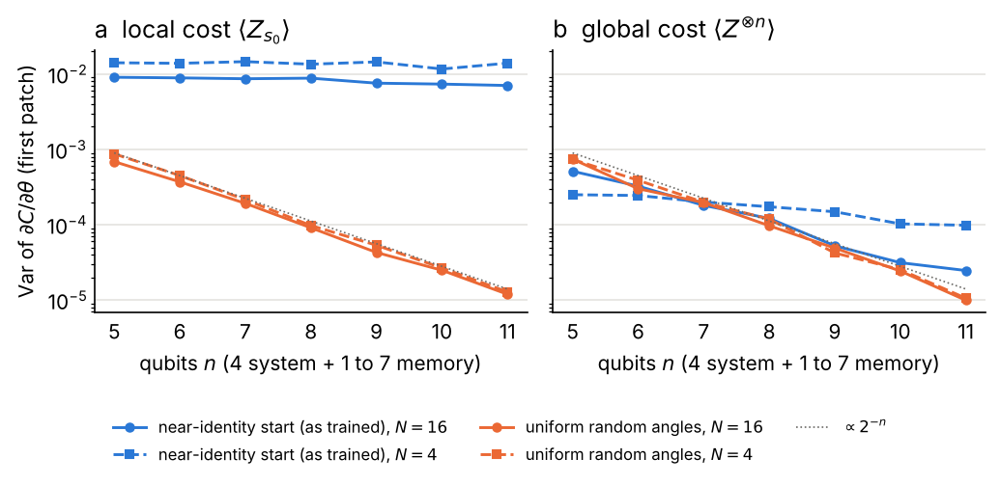

# Review experiments (Tier 1)

Experiments added after the mock npj Quantum Information review of 8 November 2026, on the splits and with the training recipe of the main runs
(100 epochs, Adam 0.01 with cosine decay, batch 256, last epoch, seeds 42-44). Result files: `data/results/review/` (110 circuit runs,
402 classical runs, `grad_variance.json`); see `data/results/README.md`. Generated by `python src/review_report.py`; the paper tables come
from the same files (`scripts/paper_figures.py`). Test accuracy in %, mean ± sample standard deviation over three seeds.

## Summary

- **Every part of the circuit that was removed costs accuracy, most on the tasks with many classes.**
  - Tying the blocks loses little on Waveform and Dry Bean, a few points on Landsat, Spambase, Wall-Following and MNIST 3 vs 5, and 9 to 12 points on Letter and MNIST 10 classes.
  - A tied block made deep enough to have the original parameter count recovers the loss on Waveform and Dry Bean and part of it on Letter, but not on Wall-Following.
- **Product gates lower the accuracy on all eight tasks**, by up to 23 points on Letter.
  - They remove every interaction between qubits, including the link through the memory, so this shows that interactions matter, not that entanglement as such is a resource.
- **The frozen random circuit with a trained head is far behind** (17 to 68 points), so the accuracy comes from training the circuit.
- **Feature order:** three random orders of the tabular features leave Waveform and Dry Bean unchanged and raise the accuracy on the other four sets, on Letter by 3 to 6 points. The file order used in the paper was not favourable to the circuit.
- **Structured classical models** read patch by patch with position-specific parameters, as the circuit does.
  - On the tabular sets the RNN and MPS match the MLP and are mostly ahead of the circuit.
  - On the 49-patch image sets the circuit is ahead of both (clearly on Kuzushiji-MNIST).
  - The 8-state HMM is the weakest model everywhere, and the measured circuit (the same eight states) beats it on 7 of 8 tabular sets and on both MNIST tasks.
- **Paired McNemar tests** (seed 42): the circuit's small deficits to the MLP on Waveform, Wall-Following, Covertype and Spambase are significant, while Credit Default, Landsat and Dry Bean show no significant difference.
- **Gradient variance:**
  - From uniform random angles the variance halves with every qubit (5 to 11 qubits), for local and global cost and for 4 and 16 patches: a barren plateau.
  - From the near-identity start of the training runs, the local-cost variance stays at about 1e-2, while the global-cost variance still falls with n.
  - The number of patches matters much less than the number of qubits.

## 1. Circuit controls

Coherent memory, L = 4. k: classes, N: patches.
- **Tied blocks:** one block W at every patch.
- **Tied, same params:** the tied block with N x L layers, run on the 4- to 6-patch sets.
- **Product gates:** every CRot replaced by a Rot on its target with the same angles.
- **Frozen random:** block angles uniform in [-pi, pi), encoding at its initial values, only the linear head trained.

| dataset | k | N | circuit | tied blocks | tied, same params | product gates | frozen random |
|---|---:|---:|---:|---:|---:|---:|---:|
| Waveform | 3 | 6 | 85.0 ± 0.2 | 84.8 ± 0.8 | 85.7 ± 0.9 | 81.6 ± 0.5 | 50.7 ± 2.6 |
| Wall-Following | 4 | 6 | 90.1 ± 0.7 | 84.5 ± 0.5 | 85.3 ± 0.5 | 81.4 ± 0.9 | 52.6 ± 1.0 |
| Letter | 26 | 4 | 71.0 ± 1.6 | 61.8 ± 0.8 | 64.7 ± 1.2 | 48.2 ± 0.5 | 30.3 ± 0.8 |
| Dry Bean | 7 | 4 | 92.9 ± 0.2 | 92.5 ± 0.1 | 92.8 ± 0.2 | 92.0 ± 0.5 | 75.5 ± 1.8 |
| Landsat | 6 | 9 | 89.3 ± 1.2 | 86.2 ± 0.9 | – | 84.0 ± 1.9 | 55.1 ± 4.0 |
| Spambase | 2 | 15 | 91.7 ± 0.4 | 88.3 ± 0.9 | – | 91.1 ± 1.1 | 64.7 ± 1.1 |
| MNIST 8x8 3 vs 5 | 2 | 16 | 97.2 ± 0.3 | 94.2 ± 0.7 | – | 95.3 ± 0.2 | 59.2 ± 1.4 |
| MNIST 8x8 10 classes | 10 | 16 | 91.1 ± 0.3 | 79.6 ± 1.7 | – | 74.5 ± 0.5 | 22.8 ± 1.7 |

Control minus circuit, paired by seed (mean, and min to max over the three seeds), in points:

| dataset | tied blocks | tied, same params | product gates | frozen random |
|---|---:|---:|---:|---:|
| Waveform | -0.2 (-1.0 to +0.5) | +0.7 (+0.1 to +1.6) | -3.3 (-3.9 to -3.0) | -34.3 (-36.6 to -31.8) |
| Wall-Following | -5.7 (-6.9 to -4.8) | -4.9 (-5.4 to -4.0) | -8.7 (-9.9 to -7.1) | -37.5 (-39.4 to -36.3) |
| Letter | -9.2 (-10.9 to -6.6) | -6.2 (-8.4 to -3.3) | -22.7 (-23.4 to -21.4) | -40.7 (-41.4 to -39.7) |
| Dry Bean | -0.4 (-0.7 to -0.3) | -0.1 (-0.3 to +0.0) | -0.9 (-1.3 to -0.5) | -17.4 (-18.9 to -15.4) |
| Landsat | -3.0 (-4.3 to -1.1) | – | -5.3 (-7.2 to -3.1) | -34.1 (-38.3 to -31.9) |
| Spambase | -3.5 (-4.3 to -2.5) | – | -0.7 (-1.8 to +0.9) | -27.0 (-28.4 to -26.2) |
| MNIST 8x8 3 vs 5 | -3.0 (-3.8 to -2.0) | – | -1.9 (-2.4 to -1.5) | -38.0 (-39.7 to -36.8) |
| MNIST 8x8 10 classes | -11.6 (-12.4 to -10.0) | – | -16.6 (-17.0 to -16.2) | -68.4 (-70.0 to -66.7) |

## 2. Feature order

Seed 42. Test accuracy with the file order, and the change with three random column orders (numpy seeds 1-3, the same for every training seed).

| dataset | file order (seed 42) | order 1 | order 2 | order 3 |
|---|---:|---:|---:|---:|
| Waveform | 85.1 | -0.8 | +0.7 | +0.6 |
| Wall-Following | 89.5 | +0.5 | +1.6 | +1.4 |
| Letter | 69.1 | +3.1 | +5.8 | +4.2 |
| Dry Bean | 92.8 | +0.0 | +0.1 | +0.1 |
| Landsat | 88.2 | +1.8 | +1.6 | +1.4 |
| Spambase | 91.3 | +1.4 | +1.0 | +2.1 |

## 3. Classical models with the structure of the circuit

Test accuracy; the best mean of each row in bold.
- **Seq. RNN:** h_t = tanh(A_t h_(t-1) + B_t x_t + c_t), with its own weights at every patch.
- **MPS:** one (2, D, D) tensor per feature with the map (cos(pi x/2), sin(pi x/2)) and a normalized boundary vector.
- **8-state HMM:** p_t = p_(t-1) P_t(x_t) with softmax rows; the readout sees [p_N, x_N].

RNN and MPS are sized as closely as H and D allow to the circuit; the HMM size is fixed by its eight states. The learning rate (0.001, 0.003, 0.01) is chosen by mean validation accuracy. For MNIST the MLP is the parameter-matched MLP of the grid. Measured memory was not run on the 49-patch image sets.

| dataset | circuit | measured | MLP | seq. RNN | MPS | 8-state HMM | params: circuit / RNN / MPS / HMM |
|---|---:|---:|---:|---:|---:|---:|---:|
| Waveform | 85.0 | 82.7 | 87.1 | 87.4 | **87.5** | 84.9 | 1056 / 1092 / 1218 / 1959 |
| Wall-Following | 90.1 | 87.0 | 91.9 | 93.1 | **95.2** | 85.7 | 1071 / 1104 / 1224 / 1972 |
| Covertype | 73.8 | 71.7 | **75.8** | 75.3 | 75.2 | 71.3 | 2364 / 2548 / 2842 / 4571 |
| Letter | 71.0 | 63.5 | 80.4 | **80.7** | 71.4 | 53.8 | 1089 / 1154 / 956 / 1618 |
| Spambase | 91.7 | 93.5 | 93.4 | 93.2 | **93.8** | 92.5 | 2445 / 2272 / 1930 / 4826 |
| Credit Default | 81.9 | **82.4** | 81.7 | 82.2 | 82.0 | 81.9 | 1041 / 1080 / 1212 / 1946 |
| Landsat | 89.3 | 86.8 | 89.2 | **89.7** | 89.6 | 83.7 | 1569 / 1656 / 1836 / 2958 |
| Dry Bean | **92.9** | 92.8 | 92.3 | 92.8 | **92.9** | 91.9 | 804 / 788 / 842 / 1371 |
| Fashion-MNIST | 82.7 | – | **85.2** | 77.1 | 82.2 | 53.0 | 7869 / 7460 / 6322 / 15810 |
| BloodMNIST | **73.8** | – | 70.3 | 64.7 | 71.9 | 44.9 | 7839 / 7438 / 6312 / 15784 |
| PneumoniaMNIST | **87.7** | – | 84.1 | 87.6 | 87.5 | 82.9 | 7749 / 7372 / 6282 / 15706 |
| Kuzushiji-MNIST | 70.4 | – | **78.7** | 61.8 | 62.1 | 31.0 | 7869 / 7460 / 6322 / 15810 |
| MNIST 8x8 3 vs 5 | 97.2 | 96.9 | 97.7 | **98.1** | 97.4 | 65.0 | 2601 / 2422 / 2058 / 5146 |
| MNIST 8x8 10 classes | 91.1 | 81.2 | **94.7** | 92.7 | 92.1 | 68.2 | 2721 / 2510 / 3260 / 5250 |

## 4. Paired test against the MLP

Seed-42 reruns of the circuit and of the MLP (at its selected learning rate) with stored test predictions; the reruns reproduce the
original accuracies (circuit exactly, MLP to within 0.1 points). Exact two-sided McNemar (binomial) test on the discordant examples.

| dataset | circuit − MLP (points) | only circuit right | only MLP right | p (exact) |
|---|---:|---:|---:|---:|
| Waveform | -2.8 | 28 | 56 | 0.003 |
| Wall-Following | -2.8 | 35 | 66 | 0.0027 |
| Covertype | -2.1 | 535 | 747 | 3.5e-09 |
| Letter | -10.8 | 172 | 606 | 1.9e-57 |
| Spambase | -1.7 | 21 | 37 | 0.048 |
| Credit Default | +0.3 | 126 | 106 | 0.21 |
| Landsat | -0.9 | 30 | 42 | 0.19 |
| Dry Bean | +0.6 | 44 | 29 | 0.1 |

## 5. Gradient variance against the number of qubits

The untrained coherent circuit, L = 4, with 1 to 7 memory qubits (n = 5 to 11), is evaluated on the same 16 random inputs for every draw.
- **Local cost:** batch mean of <Z_s0>.
- **Global cost:** batch mean of <Z x ... x Z> over all n qubits.
- **Derivative:** with respect to the R_Y angle of the first Rot on s0 in the first layer of W_1 (first) and W_N (last).
- **Identity:** N(0, 0.08^2) as in training.
- **Uniform:** block angles uniform in [-pi, pi).

**N = 4 patches** (variance over 200 initializations; first block W_1 / last block W_N)

| n | identity, local | identity, global | uniform, local | uniform, global |
|---:|---:|---:|---:|---:|
| 5 | 1.4e-02 / 1.5e-02 | 2.5e-04 / 6.6e-04 | 8.7e-04 / 1.2e-03 | 7.4e-04 / 1.2e-03 |
| 6 | 1.4e-02 / 1.8e-02 | 2.4e-04 / 5.3e-04 | 4.5e-04 / 6.2e-04 | 3.9e-04 / 6.4e-04 |
| 7 | 1.5e-02 / 1.3e-02 | 2.0e-04 / 4.1e-04 | 2.2e-04 / 3.4e-04 | 2.0e-04 / 3.4e-04 |
| 8 | 1.4e-02 / 1.6e-02 | 1.7e-04 / 3.7e-04 | 9.8e-05 / 1.4e-04 | 1.2e-04 / 1.4e-04 |
| 9 | 1.5e-02 / 1.5e-02 | 1.5e-04 / 2.9e-04 | 5.4e-05 / 7.7e-05 | 4.2e-05 / 8.7e-05 |
| 10 | 1.2e-02 / 1.4e-02 | 1.0e-04 / 2.7e-04 | 2.7e-05 / 4.9e-05 | 2.5e-05 / 4.1e-05 |
| 11 | 1.4e-02 / 1.5e-02 | 9.9e-05 / 2.2e-04 | 1.3e-05 / 1.9e-05 | 1.1e-05 / 2.0e-05 |

**N = 16 patches** (variance over 200 initializations; first block W_1 / last block W_N)

| n | identity, local | identity, global | uniform, local | uniform, global |
|---:|---:|---:|---:|---:|
| 5 | 9.1e-03 / 1.9e-02 | 5.1e-04 / 8.9e-04 | 6.9e-04 / 1.0e-03 | 7.4e-04 / 8.8e-04 |
| 6 | 8.9e-03 / 1.9e-02 | 3.3e-04 / 4.3e-04 | 3.7e-04 / 5.4e-04 | 3.0e-04 / 4.9e-04 |
| 7 | 8.7e-03 / 1.9e-02 | 1.8e-04 / 2.2e-04 | 1.9e-04 / 2.9e-04 | 2.0e-04 / 2.8e-04 |
| 8 | 8.8e-03 / 2.0e-02 | 1.2e-04 / 1.7e-04 | 9.1e-05 / 1.3e-04 | 9.7e-05 / 1.3e-04 |
| 9 | 7.6e-03 / 1.8e-02 | 5.3e-05 / 7.3e-05 | 4.3e-05 / 6.8e-05 | 4.9e-05 / 6.9e-05 |
| 10 | 7.4e-03 / 1.7e-02 | 3.1e-05 / 4.4e-05 | 2.5e-05 / 3.6e-05 | 2.4e-05 / 2.5e-05 |
| 11 | 7.1e-03 / 1.9e-02 | 2.5e-05 / 3.8e-05 | 1.2e-05 / 1.6e-05 | 1.0e-05 / 1.6e-05 |

## Caveats

- The product-gate control also cuts the memory off from the input, so it tests interactions between qubits together with entanglement.
- The frozen circuit sits in the regime where gradients and readout features concentrate; it is a weak random-feature model, not the best fixed quantum feature map.
- The feature-order control has one training seed; the depth-matched tied control ran only on the four sets with four to six patches.
- The structured classical baselines are not exactly parameter-matched (RNN within 8%, MPS within 21% and about 20% smaller on the image sets, HMM 1.5 to 2 times larger).
- The gradient study covers 5 to 11 qubits and one angle per block; it shows the trend over this range, not an asymptotic law.
